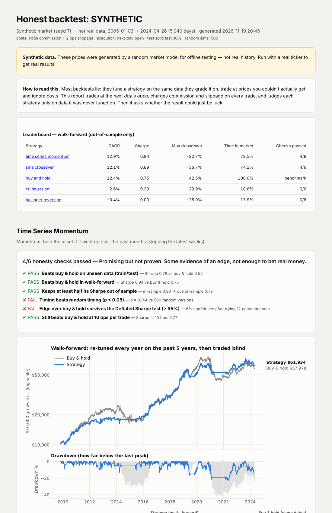

# honest-quant 📉📈

**A trading-strategy backtester that tries as hard as it can to prove your strategy is just luck.**

Most backtests you see online show amazing returns. Most of those are lying, usually without meaning to:

| The usual lie | What honest-quant does instead |
|---|---|
| Buys at today's close using a signal computed *from* today's close | Signal at the close, trade at the **next day's open** |
| No trading costs | Commission + slippage on every trade, borrow fees on shorts |
| Tunes parameters on the same data it reports results on | **Train/test split** and **walk-forward**: every result shown is on data the tuning never saw |
| Tries 50 settings and shows the best one | **Deflated Sharpe ratio**: corrects for how many settings were tried |
| "It made money" | **Random timing test**: same trades, random timing, 500 times. Is the real timing actually better? |
| Ignores the boring alternative | Everything is compared against simply buying and holding |

It ends each strategy with a verdict: *passed*, *promising but not proven*, or *most likely luck*.



---

## Quick start

```bash
git clone <your-repo-url> honest-quant && cd honest-quant
python -m venv .venv && source .venv/bin/activate      # Windows: .venv\Scripts\activate
pip install -r requirements.txt

python run_backtest.py --ticker SPY --open             # all strategies on the S&P 500 ETF
```

It downloads ~20 years of daily prices, runs every strategy through every test, and opens an HTML report.

```bash
python run_backtest.py --ticker QQQ --strategy sma_crossover    # one strategy (+ buy & hold)
python run_backtest.py --ticker SPY --vol-target 0.15           # scale positions to 15% yearly volatility
python run_backtest.py --ticker SPY --slippage-bps 10           # pessimistic costs
python run_backtest.py --csv my_prices.csv --ticker BTC         # your own data (date,open,high,low,close)
python run_backtest.py --source synthetic                       # offline fake market, no internet needed
```

## Strategies included

| Strategy | Idea |
|---|---|
| `buy_and_hold` | The benchmark. Boring and hard to beat. |
| `sma_crossover` | Trend following: hold while the fast moving average is above the slow one |
| `time_series_momentum` | Hold if the asset rose over the past months (skip the most recent weeks) |
| `bollinger_reversion` | Buy sharp dips below the recent average, sell on recovery |
| `rsi_reversion` | Buy when RSI says "oversold", sell when it bounces |

Adding your own takes one function and one line in `honestquant/strategies.py`. The function gets prices and returns a position (1 = long, 0 = flat, −1 = short) for each day, using only data up to that day's close. The test suite automatically checks every registered strategy for lookahead bias.

## How the honesty checks work

1. **Train/test split.** Tune parameters on the first 70% of history, then judge the winner only on the last 30%.
2. **Walk-forward.** Every year, re-tune on the previous 5 years, then trade the next year blind. Stitch those blind years together. This is the closest thing to what would have happened if you had actually run the bot.
3. **Random timing test.** Shift the strategy's trades around in time at random (same number of trades, same holding periods, same time in the market). If the real strategy doesn't beat ~95% of the random versions, its timing has no proven skill. This gives a p-value.
4. **Deflated Sharpe ratio** ([Bailey & López de Prado, 2014](https://papers.ssrn.com/sol3/papers.cfm?abstract_id=2460551)). If you try 27 parameter combinations, the best one looks good partly by chance. This estimates how good the best of N would look *with zero skill*, then asks how confident we can be that the strategy's edge over buy & hold beats that.
5. **Cost sensitivity.** Re-run at 0–50 bps per trade. An edge that disappears at 10 bps isn't an edge.

## Paper trading (fake money, real market)

Once something survives the tests, run it live on an [Alpaca](https://alpaca.markets) **paper** account. It's free and uses fake money.

```bash
# 1) dry run without an account
python paper_trade.py --symbol SPY --strategy sma_crossover --params '{"fast": 100, "slow": 200}'

# 2) connect your paper account (still a dry run)
export APCA_API_KEY_ID=your_paper_key
export APCA_API_SECRET_KEY=your_paper_secret
python paper_trade.py --symbol SPY --strategy sma_crossover --params '{"fast": 100, "slow": 200}' --alpaca

# 3) actually place the paper order
python paper_trade.py ... --alpaca --submit
```

Run it once per trading day **after the US market closes** (around 22:15 in the Netherlands). It reads the latest daily bar, computes tomorrow's position, and queues a market order that fills at the next open. That's the same timing the backtest assumes. Each decision is logged to `journal.csv`.

To automate it, use cron on Mac/Linux (`15 22 * * 1-5 cd /path/to/honest-quant && .venv/bin/python paper_trade.py ... --alpaca --submit`) or Task Scheduler on Windows.

**Safety:** the code only accepts Alpaca's paper endpoint. There is deliberately no real-money switch.

## Project layout

```
honestquant/
  data.py        price loading (yfinance → Stooq → CSV → synthetic), adjusted for splits/dividends
  strategies.py  strategies + parameter grids
  backtest.py    execution model, costs, borrow fees, optional volatility targeting
  metrics.py     CAGR, Sharpe, Sortino, drawdown, turnover…
  validation.py  train/test, walk-forward, random timing test, deflated Sharpe, cost sensitivity
  report.py      self-contained HTML report
  live.py        Alpaca paper-trading client with safety rails
run_backtest.py  CLI → report
paper_trade.py   CLI → daily paper trade
tests/           30 tests, incl. automatic lookahead-bias detection for every strategy
```

```bash
pytest -q
```

## What I learned

*(Fill this in after running it on real data. This is the part recruiters read.)* For example:

- Which strategy looked best in-sample, and how much of that survived out of sample?
- Did anything pass the random timing test on SPY? On other assets?
- How much did realistic costs change the picture?
- What would you test next: other assets, intraday data, portfolio of several strategies?

---

*Educational project. Simulated results say little about the future. Not investment advice.*
